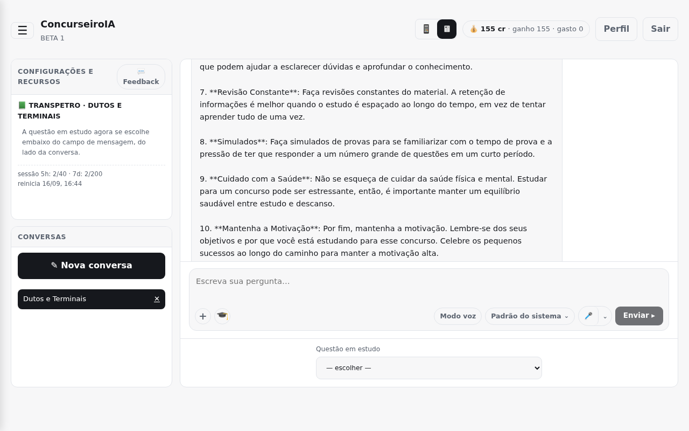
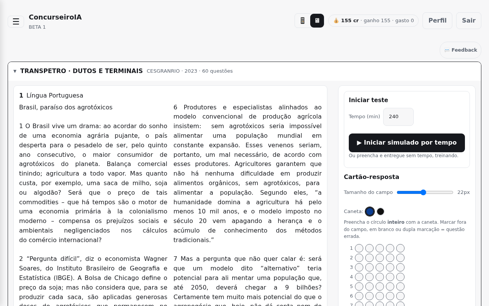
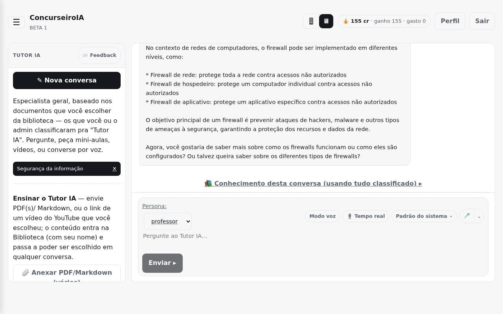

# APP Concursos

APP Concursos é uma plataforma de estudos para concursos públicos. O sistema
organiza cadernos de questões, simulados, revisão de desempenho e apoio por IA
para ajudar o estudante a treinar com base em provas, gabaritos e materiais de
estudo.

## Para Que Serve

- transformar provas e materiais em cadernos de questões;
- responder questões em modo treino ou simulado;
- corrigir respostas com base no gabarito cadastrado;
- acompanhar desempenho por disciplina, tema, subtema e histórico;
- revisar erros com repetição espaçada;
- gerar explicações, mini-aulas, macetes e questões semelhantes com IA;
- conversar com um tutor de estudos apoiado por documentos selecionados;
- centralizar a configuração de modelos, prompts, créditos e permissões em uma
  área administrativa.

## Como Usar

1. Cadastre-se ou acesse sua conta.
2. Crie ou importe um caderno de estudo.
3. Revise as questões e confirme enunciado, alternativas, gabarito e tema.
4. Responda no modo treino, simulado ou revisão.
5. Acompanhe acertos, erros, evolução e pontos fracos.
6. Use o chat ou o tutor para pedir explicações e reforçar temas difíceis.
7. No perfil administrativo, cadastre plataformas de IA, modelos, prompts,
   documentos de apoio, créditos, permissões e regras de uso.

## Demonstração Visual

As imagens abaixo mostram telas demonstrativas da aplicação, sem dados reais de
usuários, credenciais ou informações sensíveis.

<video src="frontend/public/landing/demo.webm" controls width="100%">
  Demonstração em vídeo da interface do APP Concursos.
</video>

## Lógica Do Projeto

O projeto separa a experiência do estudante da operação administrativa. O
estudante usa cadernos, simulados, revisões, chat e tutor. O administrador
prepara a base de estudo, revisa os materiais importados, configura modelos de
IA, define prompts, acompanha consumo e libera recursos conforme a regra do
produto.

A correção das questões oficiais não depende da IA: o sistema usa o gabarito
cadastrado como fonte de verdade. A IA entra como apoio pedagógico, explicando
respostas, criando questões semelhantes, estruturando mini-aulas e ajudando na
conversa de estudo.

## Frontend

O frontend é uma aplicação web em React e TypeScript. Ele organiza a navegação
por áreas como cadernos, simulados, revisão, estatísticas, chat, tutor,
biblioteca, perfil, pagamentos, prompts e painéis administrativos.

A interface foi pensada para uso diário de estudo: ações principais ficam
visíveis, conversas podem ser retomadas, questões têm revisão visual, e o aluno
consegue alternar entre estudar, simular, revisar erros e pedir explicações sem
sair do fluxo.

## Backend

O backend concentra regras de autenticação, permissões, cadastro de questões,
simulados, estatísticas, créditos, chamadas de IA, biblioteca de conhecimento,
prompts, pagamentos e auditoria de uso.

As regras importantes ficam no servidor: correção por gabarito, cálculo de
desempenho, liberação de recursos, controle de créditos, registro de consumo,
seleção de modelos e aplicação dos prompts. Assim o frontend exibe a experiência,
mas a decisão crítica fica centralizada na lógica do backend.

## Base De Dados

A base guarda usuários, cadernos, questões, alternativas, respostas, simulados,
estatísticas, documentos de apoio, trechos vetorizados, prompts, plataformas de
IA, modelos, créditos, pagamentos, permissões e registros de uso.

Os documentos de apoio são quebrados em trechos para busca semântica. Cada
documento pode ser classificado para uso no chat, no tutor ou no simulado,
permitindo que cada ferramenta consulte apenas o conhecimento adequado.

## Perfil Administrativo

O perfil administrativo é o centro de configuração do sistema. Por ele é
possível cadastrar e revisar:

- plataformas de IA;
- modelos de texto, visão, transcrição, voz e embeddings;
- prompts usados em cada ferramenta;
- documentos da biblioteca de conhecimento;
- regras de edital, temas e subtemas;
- créditos, permissões e liberações por usuário;
- ícones e ajustes visuais da interface;
- painéis de consumo, orçamento e uso por ferramenta.

As chaves e credenciais reais não aparecem no repositório. A configuração
sensível pertence ao ambiente de execução e deve ser tratada fora do código
publicado.

## IA E Modelos

O sistema foi desenhado para trabalhar com provedores compatíveis com modelos de
linguagem modernos. A configuração administrativa separa a plataforma dos
modelos, permitindo cadastrar diferentes usos para:

- texto, usado em chat, tutor, explicações e geração de questões semelhantes;
- visão, usado quando uma questão depende de imagem ou recorte visual;
- transcrição, usado para converter áudio em texto;
- voz, usado para respostas faladas;
- embeddings, usados para busca semântica em documentos de apoio.

Também há suporte para modelos locais em tarefas específicas, como embeddings,
quando isso reduz custo ou melhora o controle operacional.

## Prompts

Os prompts ficam cadastrados na base e são editáveis pelo perfil administrativo.
Cada prompt tem uma finalidade: chat de estudo, tutor, explicação de questão,
questões semelhantes, resposta baseada em documento, classificação de temas,
modo de voz e outras rotinas pedagógicas.

Essa organização evita textos fixos espalhados pelo código e permite ajustar o
comportamento da IA sem alterar a aplicação.

## Consumo E Créditos

O motor de consumo registra o uso por usuário, ferramenta, modelo e tipo de
recurso. Quando um modelo retorna dados de uso, o sistema separa entrada e saída
para calcular custo estimado. Em recursos de voz ou transcrição, o controle pode
considerar tempo de uso quando aplicável.

O painel administrativo consolida essas informações para mostrar consumo por
período, por usuário, por ferramenta e por conexão cadastrada. Isso permite
acompanhar orçamento, identificar uso intenso e ajustar limites antes que o custo
saia do controle.

O sistema de créditos permite liberar acesso, conceder saldo, registrar compras
e criar regras especiais, como usuários com acesso vitalício ou recursos
restritos liberados individualmente.

## RAG E Biblioteca

A biblioteca permite cadastrar materiais de apoio e classificá-los por uso. O
sistema gera representações semânticas dos trechos e usa busca por similaridade
para recuperar contexto relevante durante conversas, explicações e consultas ao
material.

O objetivo é fazer a IA responder com base no conteúdo cadastrado, em vez de
depender apenas do conhecimento geral do modelo.

## Segurança Da Publicação

Este repositório público deve conter somente código e estrutura do projeto. Não
devem entrar no README, na documentação ou nos commits:

- credenciais, tokens, chaves ou segredos;
- dados reais de usuários, administradores ou alunos;
- bases preenchidas, dumps, backups ou arquivos privados;
- endereços de servidor, caminhos locais ou detalhes de infraestrutura;
- configurações sensíveis do ambiente;
- arquivos internos de ferramenta, memória ou coautoria.

O README deve permanecer como descrição limpa do projeto, da lógica do produto e
do modo de uso, sem informações que facilitem invasão, enumeração ou exposição
do sistema.
